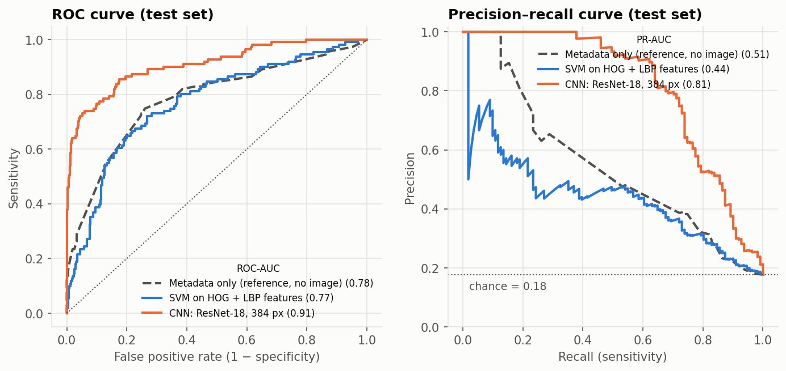
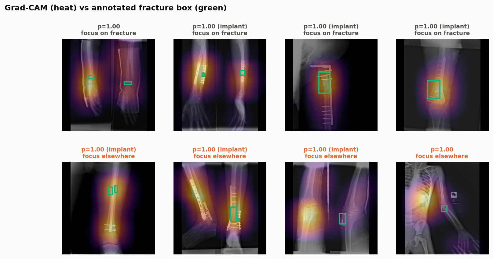
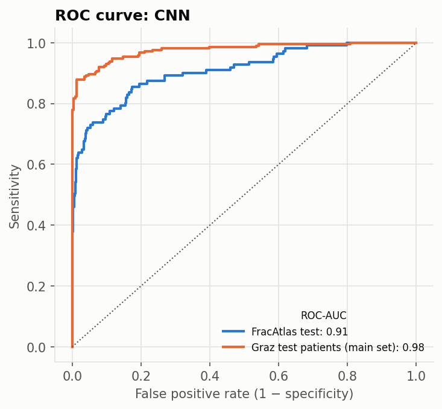

# X-Ray Fracture Detection

Detects bone fractures in X-rays of the hand, leg, hip and shoulder.

**[Try the live demo](https://vishwaraj25.github.io/xray-fracture-detection/)**: the model runs in your browser, so no
X-ray is uploaded. Click an example or drop in your own.

The project has **two models**:

| | Model | Role |
|---|---|---|
| 1 | **SVM** on hand-crafted HOG + LBP features | Baseline: the classical pipeline from the project brief |
| 2 | **CNN**: ResNet-18 fine-tuned at 384 px | Final model, used by the app |

Both are checked against a **metadata-only reference** that never looks at the image. It shows how far shortcuts
(body region, metal implants) get on their own.

**Datasets** (both CC BY 4.0):

- [FracAtlas](https://doi.org/10.6084/m9.figshare.22363012) (Abedeen et al., *Scientific Data*, 2023): 4,083 X-rays
  of the hand, leg, hip and shoulder, 719 of them fractured, with fracture boxes drawn by radiologists.
- [GRAZPEDWRI-DX](https://doi.org/10.6084/m9.figshare.14825193) (Nagy et al., *Scientific Data*, 2022), part 1 of 4:
  5,031 wrist X-rays of 1,499 children from Graz, Austria. Added to make the CNN work beyond one source
  ([below](#a-second-hospital-graz)).

## Pipeline

```
X-ray → build_dataset → preprocessing → feature_extraction → train_svm ─┐
                                      └──────────────────→ train_cnn ─┴→ evaluate → explain → predict / app
```

| Stage | Script | What it does |
|---|---|---|
| Dataset | `build_dataset.py` | Reads the labels, caches downscaled images, groups near-duplicate images with a perceptual hash, and makes a 70/15/15 train/validation/test split that keeps each group together |
| Analysis | `eda.py` | Class balance, fracture rate by region, view, implant and resolution → `reports/eda_summary.md` |
| Preprocessing | `preprocessing.py` | Grayscale, pad to a square without stretching, contrast enhancement (CLAHE); shared by both models and the app |
| Features | `feature_extraction.py` | HOG (shape), multi-scale LBP (texture), intensity histogram and edge density: 6,155 numbers per image |
| SVM | `train_svm.py` | Scaler → PCA → RBF SVM, tuned with grouped 5-fold cross-validation |
| CNN | `train_cnn.py` | ImageNet ResNet-18 at 384 px, augmentation, class-weighted loss, early stopping on validation; trained on FracAtlas plus the Graz training patients |
| Evaluation | `evaluate.py` | Test metrics with confidence intervals, threshold chosen on validation → `reports/results.md` |
| Graz | `graz.py` | Caches the Graz images and splits them 60/20/20 by patient; after training, tests the CNN on the held-out Graz patients → `reports/graz.md` |
| Explanation | `explain.py` | Grad-CAM heatmaps scored against the radiologists' boxes → `reports/gradcam.md` |
| Prediction | `predict.py` | Command line: score X-rays with the CNN or the SVM |
| Web demo | `export_web.py` | Exports the CNN to ONNX, picks the example X-rays (successes and failures) and writes everything the demo needs into `docs/` |

## Results

On the held-out FracAtlas test split: 627 X-rays, 111 of them fractured. No image in it was used for training or for
any choice.

| Model | ROC-AUC [95% CI] | PR-AUC [95% CI] | Sensitivity | Specificity |
|---|---|---|---|---|
| Metadata only (reference, no image) | 0.781 [0.73–0.83] | 0.508 [0.43–0.59] | 0.94 | 0.17 |
| SVM on HOG + LBP | 0.768 [0.71–0.82] | 0.442 [0.36–0.54] | 0.79 | 0.62 |
| **CNN: ResNet-18, 384 px** | **0.909 [0.88–0.94]** | **0.813 [0.75–0.87]** | **0.89** | **0.69** |

Random guessing scores 0.50 ROC-AUC and about 0.18 PR-AUC. The CNN finds 99 of 111 fractures and raises 161 false
alarms out of 516 normal X-rays. Full table, curves and per-region results: [reports/results.md](reports/results.md).



### Key findings

1. **The CNN is clearly better than the SVM.** PR-AUC rises from 0.44 to 0.81.
2. **The dataset has shortcuts.** 98% of X-rays with metal implants are fractured, and the fracture rate ranges from
   6% (hip) to 30% (hand). The metadata-only reference reaches 0.78 ROC-AUC, as good as the SVM, so hand-crafted
   features add little beyond these shortcuts. The CNN still scores 0.90 with implant X-rays removed, so it does more
   than spot metal.
3. **The CNN often, but not always, looks at the fracture.** Its Grad-CAM peak lands within one heatmap cell of the
   radiologist's box in 61% of the fractures it catches. Otherwise it focuses on soft tissue or film edges
   ([reports/gradcam.md](reports/gradcam.md)).
4. **Honest evaluation matters.** The first version of this project used 6 X-rays augmented by rotation, which gave
   99% accuracy with a random split and 7% on unseen X-rays. FracAtlas has no patient IDs, so near-duplicate images
   (206 groups) are found with perceptual hashing and each group stays inside one split.



### A second hospital: Graz

The first CNN was trained on FracAtlas alone. Tested on Graz wrists it had never seen, its ROC-AUC fell to 0.66:
children's open growth plates look like fracture lines, and the scanners differ. So the Graz patients were split
60/20/20 **by patient** (one child's X-rays all land in one split). The CNN was retrained on FracAtlas plus the
Graz training patients, and tested on the 296 Graz test patients, whose X-rays were never used for training or any
choice. X-rays with a cast or metal, or where the radiologist was unsure, were left out of training.

The main Graz set is first visits without a cast or metal. Same test X-rays, same rule for the threshold:

| Test set | X-rays | FracAtlas only | FracAtlas + Graz |
|---|---|---|---|
| **Graz test patients, main set** | 526 | 0.655 | **0.976 [0.96–0.99]** |
| FracAtlas test, all regions | 627 | 0.868 | **0.909** |
| FracAtlas test, hand | 210 | 0.837 | **0.899** |

ROC-AUC; the interval resamples whole patients.

5. **More varied data helped both datasets.** Graz improved sharply, and FracAtlas improved too, most on hands
   (0.84 → 0.90) but also on legs (0.87 → 0.88), which Graz does not contain. Adding the second hospital did not
   cost the first one anything.
6. **A threshold does not transfer between hospitals.** The threshold is chosen on FracAtlas validation. On Graz it
   catches 213 of 214 fractures but clears only 35% of normal wrists, because Graz scores run higher. In practice
   each hospital would set its own threshold on its own validation data.
7. **Casts act as a shortcut**, like implants in FracAtlas: almost every Graz X-ray with a cast is flagged, fractured
   or not (specificity 0.00). Full report: [reports/graz.md](reports/graz.md).



### Decision threshold

A score above the threshold means "fracture". The threshold is set on the validation split as the highest value at
which we can be **95% confident that at least 85% of fractures are caught** (one-sided Clopper–Pearson bound).
Validation has only 113 fractures, so simply hitting 85% there is noisy: on test it landed 4–10 points lower for every
model. The confidence bound adds a safety margin. On test the CNN catches 89%, above the 85% target.

### What we tried and dropped

Model choices were made on the FracAtlas validation split, before Graz was added. On validation, a higher input resolution (224 → 384 px) raised
PR-AUC from 0.74 to 0.80. A deeper network (DenseNet-121) did not help (0.73), and an ensemble of two ResNets
tied the single 384 px model (0.80), so the single model was kept as the simpler choice. Logistic regression, a random
forest and gradient boosting all scored at or below the SVM.

## Run it

```bash
python -m venv venv && source venv/bin/activate
pip install -r requirements.txt
# download FracAtlas and GRAZPEDWRI-DX into data/raw/ (see data/README.md)

python src/graz.py --prepare                 # cache and split the Graz images; the zip can then be deleted
python src/run_pipeline.py --with-graz       # every stage in order (about 2.5 hours on an Apple M2)
python src/run_pipeline.py --skip-cnn --with-graz   # reuse a trained CNN (a few minutes)
python src/predict.py path/to/xray.jpg [--model svm]
python src/export_web.py                # rebuild the web demo in docs/
python -m http.server -d docs           # open the demo at http://localhost:8000
pytest tests
```

Each stage can also be run on its own, for example `python src/evaluate.py`.

## Web demo

A minimal off-white and off-black site, in `docs/`, that runs the CNN in the browser with
[ONNX Runtime Web](https://onnxruntime.ai/docs/tutorials/web/). It is plain static files, so it is hosted for free
on GitHub Pages with no server. The model (22 MB, weights in half precision) downloads while you look around.

- Click one of the 8 held-out examples, or drop, choose or paste your own JPEG or PNG.
- The steps (open → prepare → score → where it looked → estimate) animate as they finish, each with its real timing.
- The result is an estimate, never a diagnosis: one of three levels (fracture unlikely, possible or likely) with a
  sentence on what it means, how often X-rays rated that way were really fractured in testing, and the model's test
  limits. The raw score sits under "Technical details".
- **View report** opens a short screening report to print or save as PDF: the study, the estimate, the original and
  annotated images, a suggested review step, what the model reviewed, how it was evaluated, and its limitations.
- The viewer switches between the original image, the Grad-CAM attention map with its peak ringed, and the exact
  384×384 input the network saw (keys `1`, `2`, `3`; `Esc` for a new analysis).
- For the examples, the radiologist's fracture box is drawn over the image (key `b` toggles it), and the panel says
  whether the model's attention peak landed on the fracture: the same check as `reports/gradcam.md`.
- The **How it works** page (`model.html`) covers the data, the model, what was and was not evaluated, the results and
  the limitations. It plots all 627 test X-rays by score: dragging the threshold updates the fractures caught, false
  alarms and the point on the ROC curve live.

The browser repeats the Python pipeline (grayscale, pad to a square, score the image and its mirror, Grad-CAM). On 24
random test X-rays its scores differ from PyTorch's by 0.003 on average (0.016 at most) and every verdict matches.
For this ResNet-18, Grad-CAM reduces to the last feature maps weighted by the final layer's weights, so the exported
model returns the heat-map grid directly and the browser needs no backpropagation.

## Project structure

```
src/            pipeline stages (table above) and run_pipeline.py
docs/           the web demo: page, model.onnx, example X-rays and test scores (built by export_web.py, served by GitHub Pages)
tests/          unit tests for preprocessing, features, splitting, thresholds and the ONNX export
reports/        data analysis, results, Grad-CAM report, figures and test-set predictions
data/           download instructions; raw/ and processed/ are git-ignored
models/         svm.joblib and cnn.pt (git-ignored; recreate with run_pipeline.py)
```

## Limitations

- **A third hospital is untested.** The Graz test patients come from a hospital the model trained on. The 0.66 →
  0.98 jump shows that training data from a hospital helps there; it does not prove the model works at a hospital
  it has never seen.
- **Graz has no fracture boxes here**, so the Grad-CAM check covers FracAtlas only.
- **No patient IDs.** Near-duplicate grouping reduces leakage between splits but cannot rule it out.
- **Small subgroups.** The test set has only 3 shoulder and 6 hip fractures, so those per-region scores are uncertain.
- **One training run.** The final CNN was trained once; a different random seed would give somewhat different numbers.

This is a student project and not a medical device.
