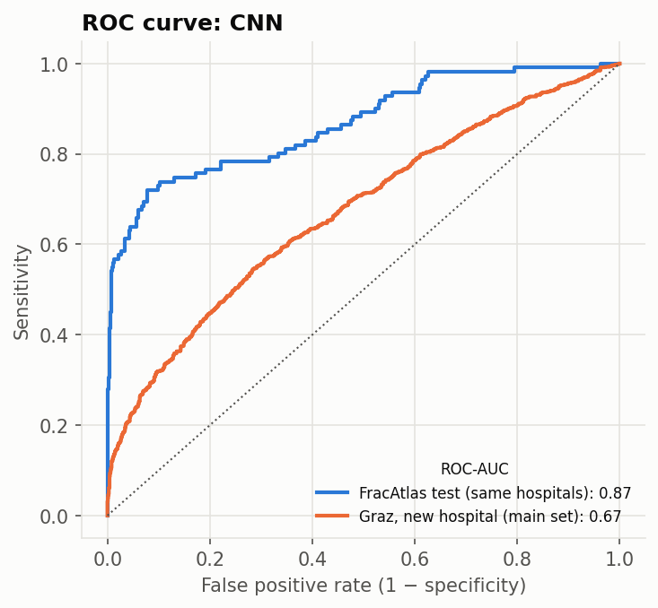

# External validation: GRAZPEDWRI-DX

The FracAtlas-trained CNN scored on paediatric wrist X-rays from Graz, Austria, with no retraining. The decision threshold (0.150) is the one chosen on FracAtlas validation.

**Main set:** first examinations without a cast or metal, where the radiologist was certain. Casts and implants are excluded because they reveal the answer without reading the bone. Confidence intervals resample whole patients.

| set | images | fractured | ROC-AUC [95% CI] | PR-AUC [95% CI] | sensitivity | specificity |
|---|---|---|---|---|---|---|
| Graz, main set | 2574 | 1084 | 0.673 [0.65–0.69] | 0.637 [0.60–0.67] | 0.72 (785/1084) | 0.47 |
| Graz, all images | 5031 | 3334 | 0.810 | 0.894 | 0.87 (2913/3334) | 0.45 |
| Graz, with cast | 1430 | 1369 | 0.540 | 0.963 | 1.00 (1366/1369) | 0.02 |
| Graz, follow-up exams | 807 | 772 | 0.777 | 0.987 | 0.86 (666/772) | 0.37 |

**Same model on FracAtlas** (for comparison):

| set | images | fractured | ROC-AUC [95% CI] | PR-AUC [95% CI] | sensitivity | specificity |
|---|---|---|---|---|---|---|
| FracAtlas test, all regions | 627 | 111 | 0.868 | 0.757 | 0.77 (85/111) | 0.80 |
| FracAtlas test, hand | 210 | 69 | 0.837 | 0.819 | 0.80 (55/69) | 0.69 |

