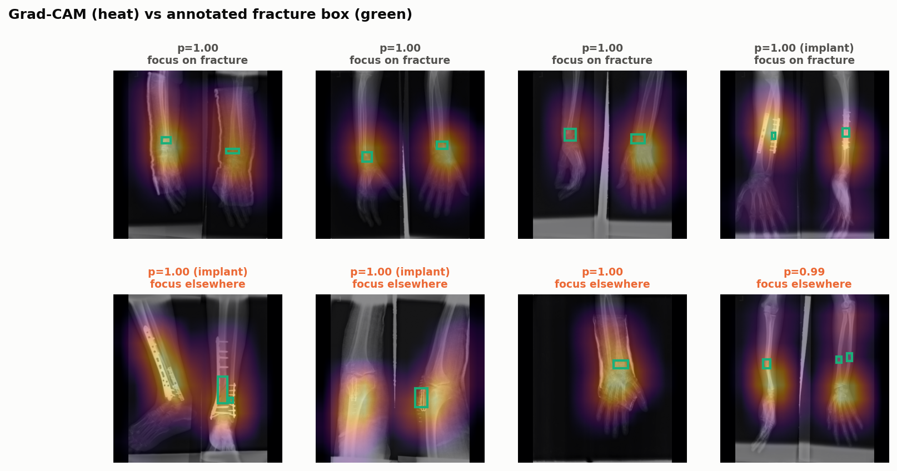

# Grad-CAM: where the CNN looks

Pointing game on test fractures the CNN correctly flagged: how often the Grad-CAM peak lies on an annotated fracture box. The CAM grid is coarse (32 px cells on a 384 px input), so both a strict and a one-cell tolerance are shown.

| images | n | peak within 14 px | peak within one CAM cell (32 px) |
|---|---|---|---|
| all | 85 | 53% | 69% |
| no implant | 72 | 50% | 69% |
| metal implant | 13 | 69% | 69% |

