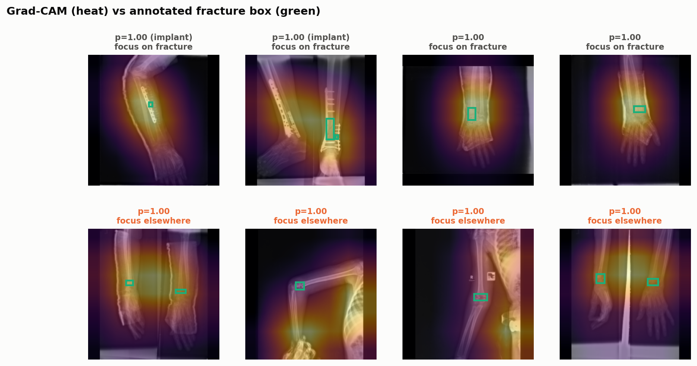

# Grad-CAM: resnet18

Pointing game on test fractures the model correctly flagged: how often the Grad-CAM peak lies on an annotated fracture box. The CAM grid is coarse (32 px cells on a 224 px input), so both a strict and a one-cell tolerance are shown.

| images | n | peak within 8 px | peak within one CAM cell (32 px) |
|---|---|---|---|
| all | 91 | 25% | 62% |
| no implant | 76 | 26% | 59% |
| metal implant | 15 | 20% | 73% |

