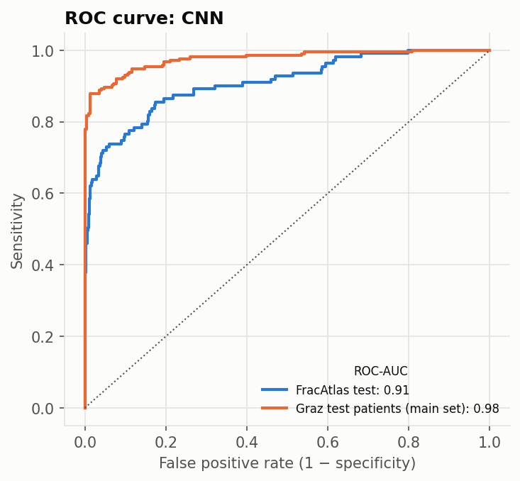

# GRAZPEDWRI-DX: paediatric wrists from another hospital

The CNN on Graz test patients, whose images were never used for training or model choice. The decision threshold (0.098) is the one chosen on FracAtlas validation.

**Main set:** first examinations without a cast or metal, where the radiologist was certain. Casts and implants are reported separately because they reveal the answer without reading the bone. Confidence intervals resample whole patients. FracAtlas rows are for comparison.

| set | images | fractured | ROC-AUC [95% CI] | PR-AUC [95% CI] | sensitivity | specificity |
|---|---|---|---|---|---|---|
| Graz test, main set | 526 | 214 | 0.976 [0.96–0.99] | 0.975 [0.96–0.99] | 1.00 (213/214) | 0.35 |
| Graz test, follow-up exams | 168 | 164 | 0.976 | 0.999 | 1.00 (164/164) | 0.25 |
| Graz test, with cast | 291 | 267 | 0.655 | 0.952 | 1.00 (267/267) | 0.00 |
| FracAtlas test, all regions | 627 | 111 | 0.909 | 0.813 | 0.89 (99/111) | 0.69 |
| FracAtlas test, hand | 210 | 69 | 0.899 | 0.867 | 0.97 (67/69) | 0.38 |

