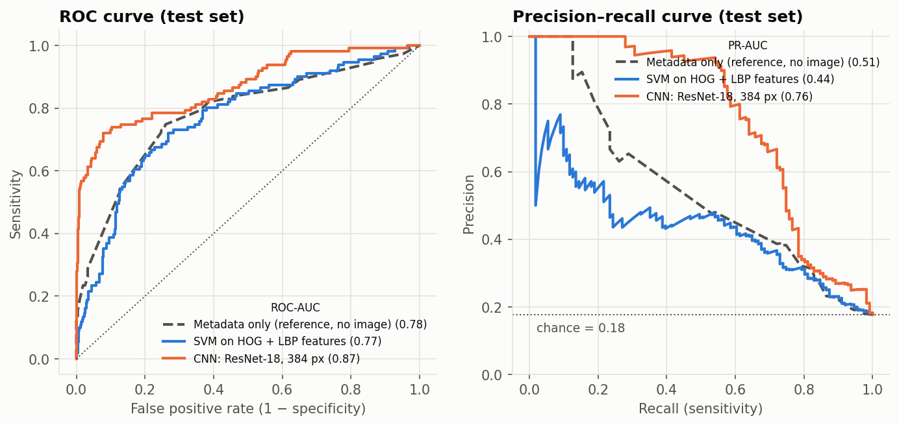
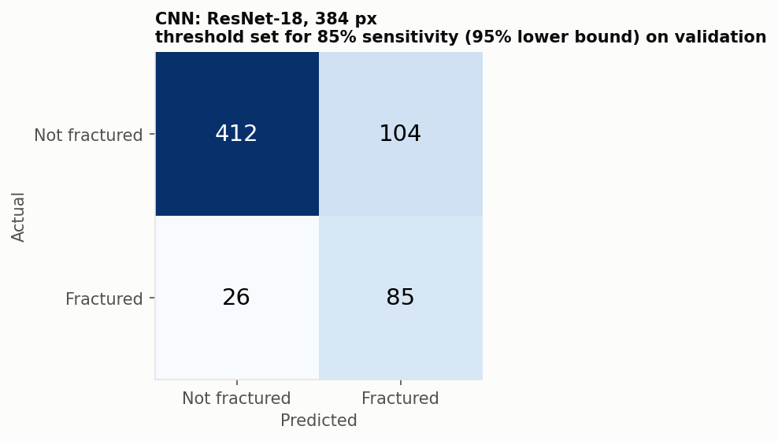
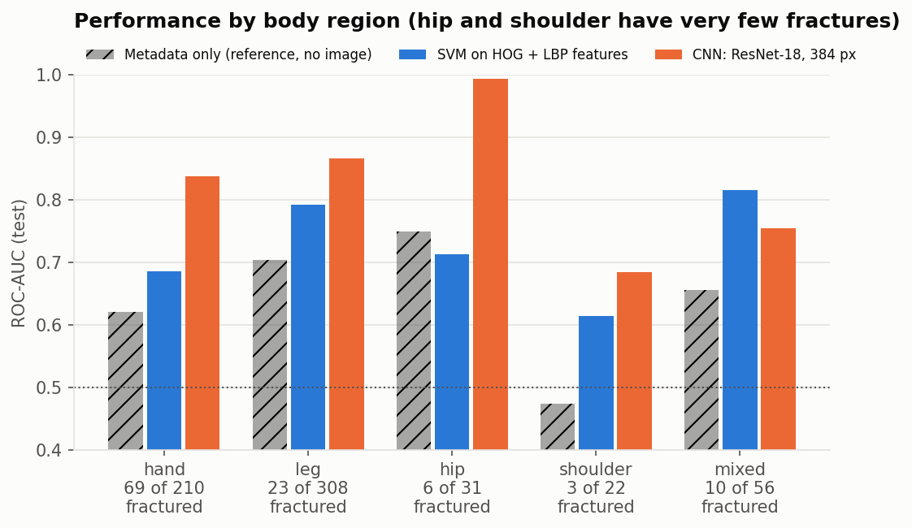

# Results

Generated by `src/evaluate.py` on the held-out **test split** (627 images, 111 fractured).
The threshold is chosen on the validation split so that, at 95% confidence (one-sided Clopper-Pearson), sensitivity is at least **85%**; it is then applied to the test split unchanged. The brackets show 95% bootstrap confidence intervals.

| Model | ROC-AUC | PR-AUC | Sensitivity | Specificity | Precision | F1 | ROC-AUC, no implants |
|---|---|---|---|---|---|---|---|
| Metadata only (reference, no image) | 0.781 [0.73–0.83] | 0.508 [0.43–0.59] | 0.94 | 0.17 | 0.20 | 0.32 | 0.747 |
| SVM on HOG + LBP features | 0.768 [0.71–0.82] | 0.442 [0.36–0.54] | 0.79 | 0.62 | 0.31 | 0.45 | 0.756 |
| **CNN: ResNet-18, 384 px** | 0.868 [0.83–0.91] | 0.757 [0.68–0.82] | 0.77 | 0.80 | 0.45 | 0.57 | 0.861 |

**The CNN** finds 85 of 111 fractures in the test set and raises 104 false alarms out of 516 normal images.

The chance level for PR-AUC is the fracture rate, about 0.18. The metadata reference never looks at the image; it shows how far shortcuts such as body region and metal implants get on their own. The "no implants" column removes the implant shortcut.

